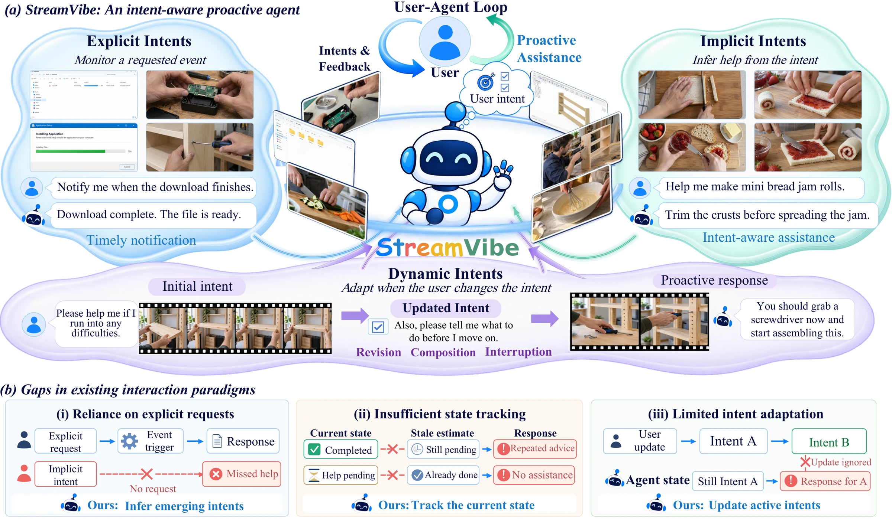

<h1 align="center"> StreamVibe</h1>
<p align="center"><strong>Proactive Video Agents for Evolving User Intent</strong></p>

<p align="center">
  <a href="https://arxiv.org/abs/2610.34662v2">Paper</a> ·
  <a href="https://stream-vibe.github.io/">Project page &amp; demo</a> ·
  <a href="#citation">Citation</a>
</p>

> **Code release:** The StreamVibe code will be released in this repository this week.

## Overview

StreamVibe studies how a video assistant can follow a user's changing goals and decide when to offer help as a live video stream unfolds.

<p align="center">
  <a href="./assets/streamvibe-overview.webp"></a>
</p>

- **StreamVibe-Bench** evaluates proactive assistance across explicit, implicit, and dynamic user intents, with 4,100 evaluation samples and 85,000 training samples.
- **StreamVibe-VL** is a streaming vision-language model that infers user intent from incoming video and decides when and how to respond.
- **StreamVibe-Harness** uses hierarchical memory to track active intents and task progress as the interaction evolves.

## Citation

```bibtex
@misc{streamvibe2026,
  title         = {StreamVibe: Proactive Video Agents for Evolving User Intent},
  author        = {Liu, Chengzhi and Lai, Yuxiang and Yang, Yuzhe and Liu, Yanqing and Hou, Jiheng and Cao, Yue and Wang, Haonan and Fan, Ruixi and Wang, Lan and Liu, Sheng and Peng, Songyou and Song, Yale and Lin, Kevin Qinghong and Wang, Xin Eric and Lai, Jui-Hsin and Tang, Youbao},
  year          = {2026},
  eprint        = {2610.34662v2},
  archivePrefix = {arXiv},
  primaryClass  = {cs.CV},
  url           = {https://arxiv.org/abs/2610.34662v2}
}
```

## License

The original code was released under the [Apache License, Version 2.0](https://www.apache.org/licenses/LICENSE-2.0).

## Disclaimer

This is not an officially supported Google product. This project is not eligible for the [Google Open Source Software Vulnerability Rewards Program](https://bughunters.google.com/open-source-security).
